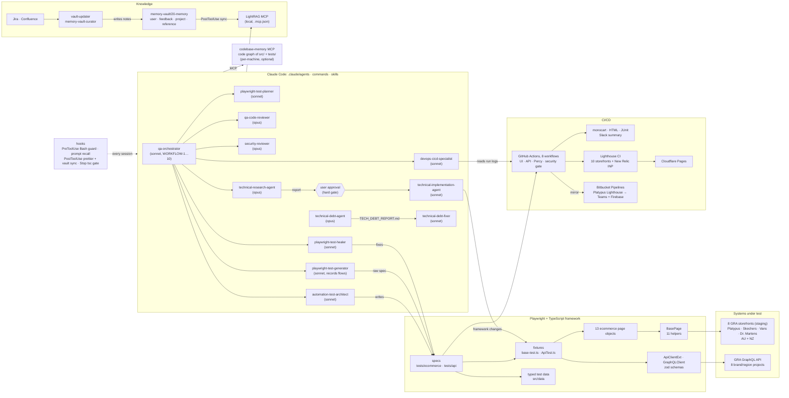

# playwright-typescript

[](https://github.com/hoanglk12/playwright-typescript/actions/workflows/playwright-with-slack.yml)
[](https://github.com/hoanglk12/playwright-typescript/actions/workflows/api-restful-tests-with-slack.yml)
[](https://github.com/hoanglk12/playwright-typescript/actions/workflows/security.yml)
[](https://playwright-lighthouse-reports.pages.dev)

A Playwright + TypeScript automation framework for the AG **GRA e-commerce platform**, plus a set of Claude Code
agents that plan, write, run, heal and review its tests. The framework covers UI tests for 8 brand storefronts and a
GraphQL API suite that runs once per brand and region. The agents work from a Markdown memory vault served over
LightRAG, and hooks, a type-check gate and a reviewer agent check their output before it lands.

The systems under test are the GRA staging storefronts for **Platypus, Skechers, Vans and Dr. Martens**, in AU and
NZ, and the GRA GraphQL API behind them. A few public sandbox APIs (DummyJSON, restful-booker, restful-api.dev)
cover the generic REST client.

**Stack:** Claude Code subagents, skills, commands and hooks · MCP (LightRAG, codebase-memory) · Playwright 1.61 +
TypeScript 5.9 on Node 22 · zod · axe-core · Percy · Lighthouse CI · monocart-reporter · New Relic · GitHub
Actions · GitLab CI · CircleCI · Azure Pipelines · Bitbucket Pipelines · Docker

## Proof

| Claim                                  | Evidence                                                                                                                                                                                                                                                                   |
| -------------------------------------- | -------------------------------------------------------------------------------------------------------------------------------------------------------------------------------------------------------------------------------------------------------------------------- |
| One suite covers every brand storefront | UI specs loop over the 8 storefronts in [`storefronts.ts`](../src/data/ecommerce/storefronts.ts). API specs run as 8 brand/region projects (`pla-au` … `van-nz`) in [`api.config.ts`](../api.config.ts), 8 workers, sequential within a spec                              |
| The suite is real, not a demo          | `--list` on 2026-10-19: 526 UI tests in 19 files on Chromium (1,058 with Firefox). 938 API test runs from 22 files: 16 `gra-*.spec.ts` files run per brand/region (counts vary by region, e.g. 116 for `pla-au`), plus 46 `misc-api` tests                                                                            |
| API responses are contract-checked     | 14 zod schema modules in [`src/data/api/schemas/`](../src/data/api/schemas/), one per GRA feature domain plus shared types                                                                                                                                                  |
| Failures arrive with context, not noise | Redacted API request/response logs and console/page-error logs are buffered per test and attached only when a test fails ([`verbose-log-buffer.ts`](../src/utils/verbose-log-buffer.ts), [`redact.ts`](../src/utils/redact.ts), [`console-helper.ts`](../src/pages/helpers/console-helper.ts)) |
| Agent output is checked                | A PreToolUse hook blocks risky Bash commands. The Stop hook runs `tsc --noEmit` and up to 3 changed specs. `qa-code-reviewer` ends every code-producing workflow, and research never turns into implementation without user approval ([`.claude/settings.json`](../.claude/settings.json)) |
| Security and performance are tracked   | npm audit + Semgrep on every push ([`security.yml`](../.github/workflows/security.yml)). Lighthouse desktop + mobile for 10 storefronts with New Relic INP (p75), published to [Cloudflare Pages](https://playwright-lighthouse-reports.pages.dev), warn-only        |

## Quick start

Prerequisites: Node 22 (what CI pins). Copy `.env.example` to `.env.testing` (or `.env.staging`) and fill in the
values. Never commit them.

```bash
npm ci
npm run install:browsers
npm run lint                     # tsc type-check, no emit
npm run test:simple              # UI on Chromium, 1 worker
npm run test:api                 # API: 8 GRA brand/region projects + misc-api
npm run test:staging             # loads .env.staging, Chromium + Firefox
npm run report:monocart          # interactive report
```

The agents need a Claude Code login. Open the repo in Claude Code and type `/write-tests <user story>`, or
`/fix-test <spec>` for a red test. LightRAG recall is optional: start it with `scripts/start-rag.bat`, and the
prompt hook skips recall when the server is unreachable or times out.

## What the agents do

| Area            | Workflows                                                                                                                                       |
| --------------- | ----------------------------------------------------------------------------------------------------------------------------------------------- |
| Plan            | `/write-tests` requirement → tests (WORKFLOW-1) · plan-then-build from the live app with `playwright-test-planner` (WORKFLOW-2)                 |
| Build           | `/new-ui-test` · `/new-api-test` · `/new-page-object` · `/new-manual-test GRA-XXXX` · record-then-refine with `playwright-test-generator` (WORKFLOW-3) |
| Run             | `/run-ui` · `/run-api`                                                                                                                          |
| Fix             | `/fix-test` targeted healing (WORKFLOW-6) · `/check-ci` CI failure investigation (WORKFLOW-4) · write, run, heal and verify (WORKFLOW-7)        |
| Review          | `/review` code-quality audit (WORKFLOW-5) · `/security-audit` (WORKFLOW-8) · `/code-simplifier` on `.ts` files the code-producing agents write             |
| Tech debt       | `technical-debt-agent` → `TECH_DEBT_REPORT.md` · `/fix-debt` by ID, phase or severity                                                           |
| Change delivery | `/research` report (WORKFLOW-9) → **user approval** → `/implement` (WORKFLOW-10), then reviewer + DevOps verify                                |
| Knowledge       | `/vault-update` Jira or Confluence → vault note · `/sync-vault` vault → LightRAG · `memory-vault-curator` link enrichment                       |

`qa-orchestrator` is the single entry point. It picks the workflow and dispatches the specialists, so you don't
have to know the order. See [`.claude/agents/qa-orchestrator.md`](../.claude/agents/qa-orchestrator.md).

## How it works



| Part                                       | In short                                                                                                                       |
| ------------------------------------------ | ------------------------------------------------------------------------------------------------------------------------------ |
| [Agents](../.claude/agents/)               | 14 subagents on the right model, 16 slash commands, 22 skills; `qa-orchestrator` routes 10 workflows                           |
| [Hooks](../.claude/hooks/)                 | Bash guard, LightRAG recall on each prompt, prettier and YAML checks, vault sync, advisor nudge, Stop-time type-check gate     |
| [Knowledge](../memory-vault/)              | A Markdown vault (the source of truth) → LightRAG over MCP; Jira and Confluence pulled in by `vault-updater`                   |
| [Framework](../src/)                       | `BasePage` + 11 helpers, 13 page objects, fixtures, `ApiClientExt` / `GraphQLClient`, zod schemas, typed data, CI-aware timeouts |
| [Tests](../tests/)                         | Ecommerce smoke, regression, integration and accessibility; GRA GraphQL API per brand; one-off manual-assist specs             |
| [CI/CD](../.github/workflows/)             | 8 GitHub Actions workflows, plus GitLab CI, CircleCI, Azure Pipelines and a Platypus-only Bitbucket Lighthouse pipeline        |
| [Rules](../CLAUDE.md)                      | The conventions every agent follows: imports, locators, test data, soft assertions, naming, loop contract                      |

## Project structure

```
├─ src/
│  ├─ pages/            base-page.ts · ecommerce/ (13 page objects) · helpers/ (11 BasePage helpers, plus percy,
│  │                    console and page-ref)
│  ├─ api/              ApiClient · ApiClientExt · GraphQLClient · ApiTest fixtures · services/ (dummyjson,
│  │                    restful-booker, restful-device) · config/
│  ├─ config/           base-test.ts (UI fixtures) · environment.ts · global-setup · global-teardown
│  ├─ data/             api/ (GRA test data, shared GraphQL operations, zod schemas/) · ecommerce/ (storefronts,
│  │                    accounts, payments, promo codes, analytics events, reviews)
│  ├─ constants/        timeouts.ts (longer in CI, shorter locally)
│  └─ utils/            test-logger · soft-assert-helper · redact · verbose-log-buffer
├─ tests/
│  ├─ ecommerce/        smoke (13) · regression (4) · integration (1) · accessibility (1)
│  ├─ api/              gra-*.spec.ts (16, run per brand/region) · dummyjson · restful-booker · objects-crud ·
│  │                    security-posture · global setup/teardown · shared-state
│  └─ manual/           one-off manual-assist specs for Jira/Xray cases (gitignored, never in CI)
├─ .claude/             agents/ (14) · commands/ (16) · skills/ (22) · hooks/ · settings.json
├─ memory-vault/        20-memory/ (user, feedback, project, reference) · templates/ · 00-index.md
├─ scripts/             LightRAG sync, eval and ingest · Jira bulk ingest · Lighthouse index · New Relic INP fetch
├─ docs/                study/ · technical-research/ · code-improvement/
├─ postman/             PLA GraphQL Postman collection
├─ .github/workflows/   UI, API, Percy, Lighthouse, security gate, Bitbucket mirror
├─ .gitlab-ci.yml · .circleci/ · azure-pipelines.yml · bitbucket-pipelines.yml
├─ Dockerfile · docker-compose.yml   chromium, firefox, webkit, api and dev containers
├─ lighthouserc*.js     desktop + mobile budgets (the .bitbucket copies are kept in sync by hand)
├─ playwright.config.ts UI projects: chromium · firefox
├─ api.config.ts        API projects: 8 GRA brand/region + misc-api, 8 workers
├─ manual.config.ts     manual-assist specs, headed, paused for a tester
├─ security-patch.config.ts  security-posture regression pack
├─ .mcp.json            LightRAG MCP server for Claude Code
└─ CLAUDE.md            rules every agent follows
```

Generated and gitignored: `playwright-report/`, `test-results/`, `api-report/`, `api-results/`, `monocart-report/`,
`monocart-api-report/`, `lighthouse-reports/`, `.auth/` (storage states), `.lightrag/` (index), `tests/manual/`.
